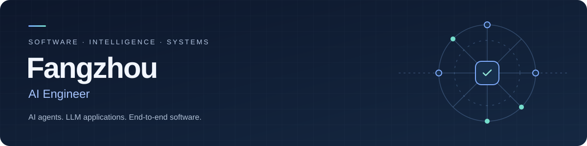

<p align="center">
  
</p>

<p align="center">
  <strong>NUS Master of Computing (AI)</strong> &nbsp;·&nbsp; <strong>3 years of software engineering experience</strong>
</p>

<p align="center">
  Building AI applications with reliable execution, traceable outputs, and usable interfaces.
</p>

<p align="center">
  <a href="https://www.linkedin.com/in/fangzhou-x-5208b31a1/"></a>
  &nbsp;
  <a href="https://github.com/Fangzhou26?tab=repositories"></a>
  &nbsp;
  
</p>

## Background

| Period | Education & experience |
| :--- | :--- |
| 2019–2023 | **BSc in Business Analytics** · School of Computing, National University of Singapore |
| 2023–2026 | **Software Engineer in FinTech** · 3 years of software engineering experience |
| 2024–2026 | **Master of Computing, specialising in AI** · School of Computing, National University of Singapore |

## Projects

### [Research Paper Agent](https://github.com/Fangzhou26/research-paper-agent)

**From seed papers to an evidence-grounded related-work draft.**

A research-agent MVP with academic search, corpus screening, and a browser execution console. Designed to make each research step inspectable and its output traceable to sources.

| Execution | Evidence | Reliability |
| :--- | :--- | :--- |
| Validated task plans and allowlisted tool calls | Paper retrieval, structured notes, and source passages | Saved checkpoints and resumable execution |
| Streamed task and tool events | Citation-key validation and provenance manifests | Offline demo with injected failure and recovery |

<details>
<summary><strong>See the workflow &amp; demo</strong></summary>

```text
Seed PDFs → Search & screening → Task plan → Research tools
                                             ↓
                         Draft + provenance ← Citation audit
```

The offline demo uses a synthetic corpus and scripted model decisions while exercising the actual executor, tools, checkpoints, and output validation. It recovers from a simulated provider outage and rejects an invented citation key. Citation-key validation does not establish that every claim is supported by a source.


</details>

<sub>Python · FastAPI · OpenAI-compatible APIs · pytest</sub>

[Explore the repository →](https://github.com/Fangzhou26/research-paper-agent) &nbsp; [Demo walkthrough →](https://github.com/Fangzhou26/research-paper-agent/blob/main/DEMO.md)

### [SmartSG](https://github.com/CS5224-2025sem2-Group3/SmartSG)

**AI-assisted development across a complete application workflow.**

A student housing and roommate-matching application connecting a Vue frontend with Spring Boot APIs. Includes registration and login, housing search, favorites, roommate profiles, rule-based matching, groups, and invitation acceptance or rejection.

<sub>Java · Spring Boot · Vue 3 · Pinia · REST APIs</sub>

[View repository →](https://github.com/CS5224-2025sem2-Group3/SmartSG)

### [Medication Refill Planner](https://github.com/Fangzhou26/medication-refill-planner)

**A mobile-first interface for inventory and refill schedules.**

A frontend prototype with a calendar, inventory coverage visualization, and medication-detail interactions. Uses fictional data and static schedule examples; deployed to GitHub Pages through GitHub Actions.

<sub>React · TypeScript · Vite · GitHub Actions</sub>

[Try the live demo →](https://fangzhou26.github.io/medication-refill-planner/) &nbsp; [View repository →](https://github.com/Fangzhou26/medication-refill-planner)

## Toolkit

<p>
  
  
  
  
  
  
  
  
  
</p>

**Agent engineering:** LLM API integration · Tool calling · Task planning · Evidence retrieval · Citation auditing · Checkpoint recovery

---

<p align="center">
  <a href="https://www.linkedin.com/in/fangzhou-x-5208b31a1/">Let's connect on LinkedIn →</a>
</p>
